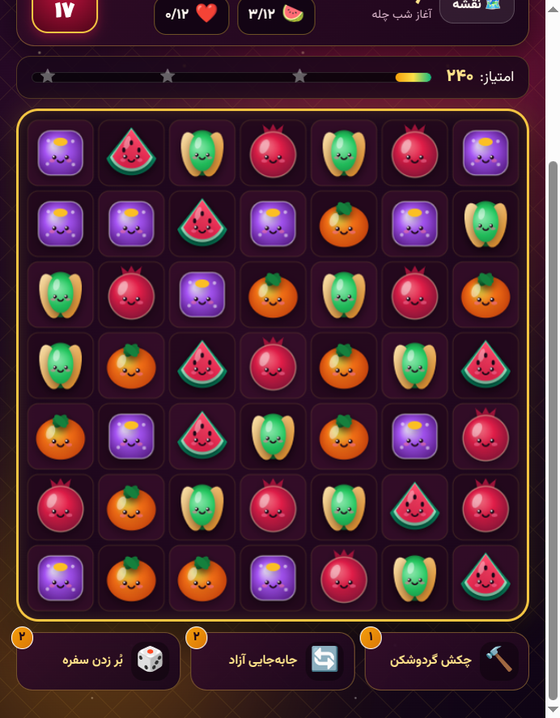
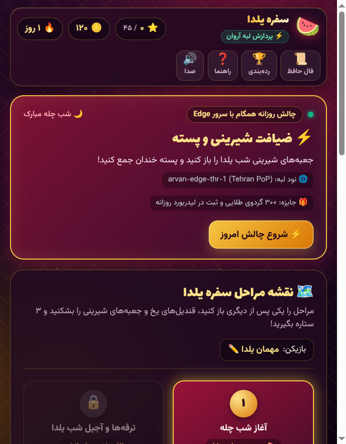
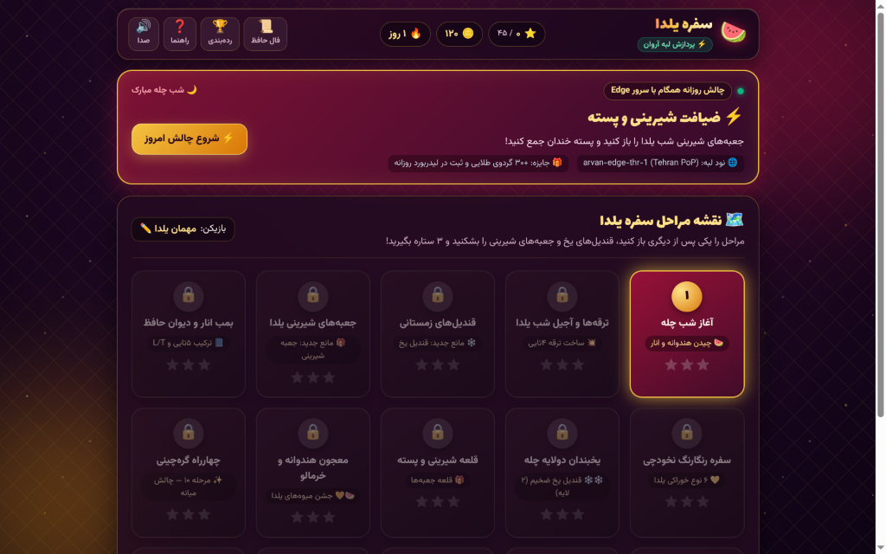

# 🍉 سفره یلدا (Sofreh Yalda) — بازی پازل شب چله روی پردازش لبه آروان‌کلاد

[](https://sofreh-yalda.mheghbalpoor-0lkub.arvanedge.ir/)

🔗 **لینک اجرای آنلاین بازی (ArvanCloud Edge):** **[https://sofreh-yalda.mheghbalpoor-0lkub.arvanedge.ir/](https://sofreh-yalda.mheghbalpoor-0lkub.arvanedge.ir/)**

**سفره یلدا** یک بازی پازل و جورچین (Match-3 به سبک کندی کراش) با حال‌وهوای اصیل شب یلدا است که به‌طور اختصاصی برای **مسابقه بازی‌سازی روی پردازش لبه آروان‌کلاد (`edge-games`)** طراحی و پیاده‌سازی شده است.

---

## 🖼️ تصاویر محیط بازی (Screenshots)

| سفره بازی و خوراکی‌های یلدایی | نقشه مراحل و چالش روزانه لبه | فال حافظ شب یلدا |
| :---: | :---: | :---: |
|  |  |  |

---

## ✨ ویژگی‌های کلیدی بازی

### ۱. گیم‌پلی مرحله‌ای کلاسیک (نقشه ۱۵ مرحله‌ای سفره یلدا)
- **۶ خوراکی اصیل یلدایی با طراحی گرافیکی Kawaii و براق روی Canvas:**
  - 🍉 **قاچ هندوانه**
  - ❤️ **انار یاقوتی**
  - 💚 **پسته خندان**
  - 🧡 **خرمالوی طلایی**
  - 💜 **باسلوق یاقوت بنفش**
  - 💛 **شیرینی نخودچی زعفرانی**
- **بمب‌های ترکیبی کندی‌کراشی:**
  - 💥 **ترقه خطی (۴تایی افقی یا عمودی):** پاکسازی کامل یک سطر یا ستون با پرتو لیزر طلایی.
  - 💣 **بمب انار انفجاری (ترکیب L یا T):** انفجار مربع ۳×۳ اطراف خود.
  - 📘 **دیوان حافظ رنگ‌پاک‌کن (۵تایی در یک خط):** حذف تمام خوراکی‌های هم‌رنگ در کل صفحه با صاعقه طلایی (و قابلیت ترکیب دو بمب با هم برای تبدیل کل یک رنگ به ترقه یا بمب انار!).
- **موانع جذاب مرحله‌ای:**
  - ❄️ **قندیل یخ زمستانی (۱ لایه و ۲ لایه):** لایه یخ روی خوراکی‌ها که با جور شدن خوراکی داخلش یا موج انفجار می‌شکند.
  - 🎁 **جعبه شیرینی یلدایی:** مانع ثابت که با جور شدن خوراکی‌های خانه‌های مجاور یا برخورد موج ترقه/بمب باز می‌شود.
- **ابزارهای کمکی پایین صفحه (Boosters):**
  - 🔨 **چکش گردوشکن:** شکستن فوری هر خوراکی، قندیل یخ یا جعبه شیرینی بدون مصرف حرکت.
  - 🔄 **جابه‌جایی آزاد:** تعویض هر دو خانه مجاور حتی بدون جور شدن.
  - 🎲 **بُر زدن سفره:** چیدمان مجدد تمام خوراکی‌های روی سفره.
- **صداگذاری سنتور ایرانی (Web Audio Synthesizer):** تولید نغمه‌های سنتور در گام همایون/اصفهان بدون نیاز به فایل صوتی خارجی و کاملاً بدون کپی‌رایت.

---

## ⚡ قابلیت‌های پردازش لبه آروان (امتیاز ویژه داوری فنی)

در این پروژه، علاوه بر تحویل فوق‌سریع رابط کاربری از روی لبه (Edge)، منطق بک‌اند و ضدتقلب نیز روی **ArvanCloud Edge Compute** اجرا می‌شود:

1. **`POST /api/session` — صدور نشست امضاشده دیجیتال روی لبه:** هنگام شروع هر مرحله، یک توکن نشست با امضای رمزنگاری‌شده (`HMAC-FNV`) روی Edge صادر می‌شود.
2. **`POST /api/submit-score` — موتور اعتبارسنجی امتیاز و ضدتقلب (Edge Anti-Cheat):**
   - بررسی صحت امضای دیجیتال نشست بازی
   - بررسی منطقی نسبت امتیاز به تعداد حرکت، آبشارها (Cascades) و بمب‌های منفجرشده برای جلوگیری از ارسال امتیازهای جعلی
   - جلوگیری از تکرار نشست (Replay Protection)
3. **`GET /api/leaderboard` — جدول رده‌بندی دوگانه روی لبه:**
   - رده‌بندی نقشه مراحل (بر اساس مجموع ستاره‌ها و امتیاز کل)
   - رده‌بندی چالش روزانه
4. **`GET /api/daily` — مولد چالش روزانه همگام با لبه:** تولید سید (Seed) و قوانین چالش روزانه بر اساس تاریخ روز روی سرور لبه.
5. **`GET /api/fal` — سرویس فال حافظ شب یلدا روی لبه:** تولید غزل، تفسیر یلدایی و نکته بازی با قابلیت اشتراک‌گذاری.

---

## 🚀 راهنمای اجرا و ساخت باندل پردازش لبه

### اجرای محلی (Local Development)
```bash
npm start
# بازی روی آدرس http://localhost:3080 اجرا می‌شود
```

### ساخت باندل نهایی برای پنل آروان‌کلاد
```bash
npm run build
```
این دستور فایل یکپارچه `dist/arvan-edge-worker.js` را تولید می‌کند که کل فرانت‌اند و تمام APIهای پردازش لبه را در یک اسکریپت Serverless واحد جای داده است.
